# Tabular Machine Learning for Binary Classification


[](main.py)
[](pyproject.toml)

A Python workflow for data preparation, seven-model comparison, performance evaluation, and SHAP interpretation using a synthetic diabetes dataset.

**[main.py](main.py) includes detailed Chinese comments throughout the analysis.** The [Chinese learning notes](LEARNING_NOTES.md) explain the methods, Python functions, parameters, and how to read the figures.

[What's included](#whats-included) · [Data and workflow](#data-and-workflow) · [Model evaluation](#model-evaluation) · [SHAP interpretation](#shap-interpretation) · [Run locally](#run-locally) · [Repository structure](#repository-structure)

## What's included

| Area | Methods and outputs |
| --- | --- |
| **Data exploration** | Variable types, class frequencies, missingness summaries, histograms, boxplots, and a development/test descriptive table using `TableOne`. |
| **Data cleaning** | IQR-based outlier identification, correction of predefined glucose errors, and missing-value imputation with `MissForest`. |
| **Feature engineering** | Continuous-variable standardization with `StandardScaler`; univariable and multivariable Logistic feature screening; a separate LASSO feature-selection example. |
| **Seven classifiers** | Logistic Regression, Decision Tree, Random Forest, XGBoost, LightGBM, Support Vector Machine (SVM), and Artificial Neural Network (ANN / multilayer perceptron). |
| **Training and tuning** | Stratified training/validation/test splits, default-versus-tuned model comparison, validation-AUC grid search, and model saving/loading. |
| **Numerical evaluation** | ROC AUC with 95% bootstrap confidence intervals, accuracy, precision, sensitivity/recall, specificity, and F1 score. |
| **Evaluation plots** | Confusion matrices, ROC curves, calibration curves, and decision curve analysis (DCA), for validation and test evaluation. |
| **SHAP interpretation** | Bar, beeswarm, dependence, waterfall, and single-/multiple-sample force plots, including interactive HTML outputs for all seven models. |
| **Reproducible workflow** | Python 3.13.2, `uv.lock`, saved data splits and processed datasets, fitted models, CSV tables, and figures. |

## Data and workflow

[The dataset](data/synthetic_diabetes.csv) contains **627 samples, 13 predictors, and one binary outcome (`diabetes`, 0/1)**. Predefined glucose errors and 84 missing insulin values provide examples for data cleaning. All results below use this synthetic dataset.

| Split | Samples | Positive | Negative |
| --- | ---: | ---: | ---: |
| Training | 306 | 103 | 203 |
| Validation | 132 | 44 | 88 |
| Test | 189 | 63 | 126 |

**Explore and check data → correct predefined errors → stratified split → impute and standardize → select features → train and tune → evaluate → explain.**

Imputation and standardization are fitted on the training predictors and applied to validation and test data. Logistic regression uses four training-selected predictors on their original scale; the other six models use all 13 predictors, with seven continuous variables standardized. LASSO is a separate feature-selection demonstration.

The six non-Logistic models use grid search on the fixed validation set. Selected models are evaluated on the held-out test set without refitting on the combined development set.

<details>
<summary>Additional visualizations: Data exploration and decision-tree visualization (click to expand)</summary>

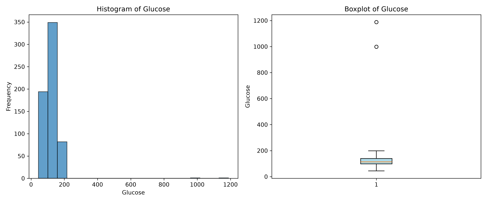

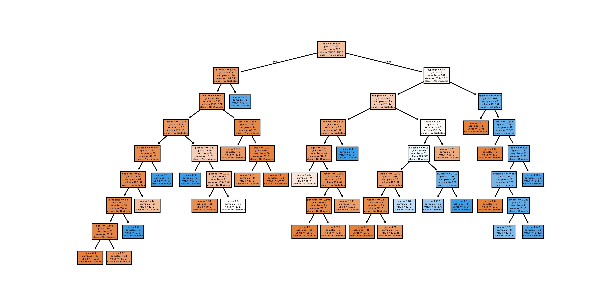

</details>

## Model evaluation

Test-set results (**n = 189**). Classification metrics use a **0.5 probability threshold**; AUC intervals use **2,000 class-stratified bootstrap resamples** of the test predictions.

| Model | AUC (95% CI) | Accuracy | Precision | Sensitivity | Specificity | F1 |
| --- | --- | ---: | ---: | ---: | ---: | ---: |
| Logistic Regression | 0.845 (0.784–0.899) | 0.788 | 0.735 | 0.571 | 0.897 | 0.643 |
| Decision Tree | 0.763 (0.688–0.831) | 0.746 | 0.612 | 0.651 | 0.794 | 0.631 |
| Random Forest | 0.867 (0.806–0.917) | 0.794 | 0.786 | 0.524 | 0.929 | 0.629 |
| XGBoost | 0.862 (0.805–0.910) | 0.772 | 0.763 | 0.460 | 0.929 | 0.574 |
| LightGBM | 0.866 (0.811–0.914) | 0.778 | 0.784 | 0.460 | 0.937 | 0.580 |
| SVM | 0.891 (0.839–0.934) | 0.810 | 0.846 | 0.524 | 0.952 | 0.647 |
| ANN | 0.888 (0.836–0.930) | 0.810 | 0.765 | 0.619 | 0.905 | 0.684 |

Full results: [validation CSV](outputs/tables/model_performance_validation.csv) · [test CSV](outputs/tables/model_performance_test.csv).

Random Forest had the highest validation AUC (0.900) and is used for the confusion-matrix and SHAP examples. The other evaluation plots compare all seven models.

<table>
  <tr>
    <th width="50%">Test ROC curves</th>
    <th width="50%">Random Forest · test confusion matrix</th>
  </tr>
  <tr>
    <td><a href="outputs/figures/evaluation/ROC_curves_allmodel_test.png">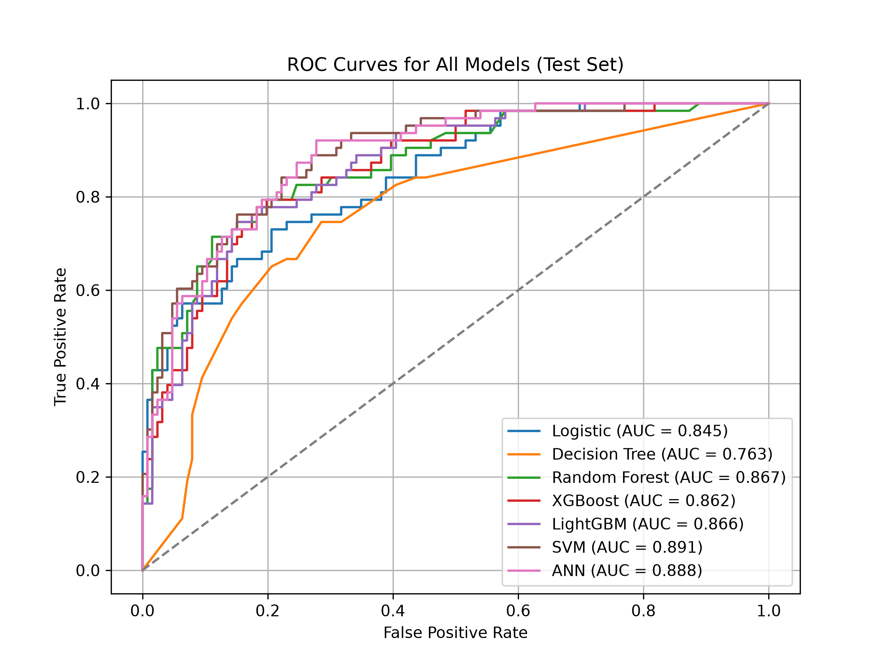</a></td>
    <td><a href="outputs/figures/evaluation/confusion_matrix_rf_test.png">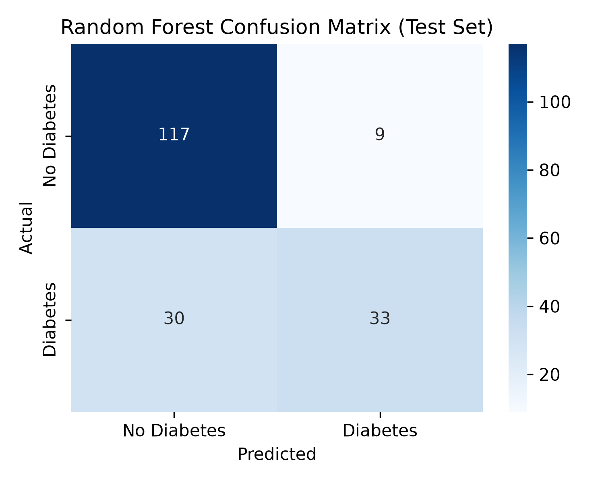</a></td>
  </tr>
</table>

<table>
  <tr>
    <th width="50%">Test calibration curves</th>
    <th width="50%">Test decision curves</th>
  </tr>
  <tr>
    <td><a href="outputs/figures/evaluation/Calibration_curves_allmodel_test.png">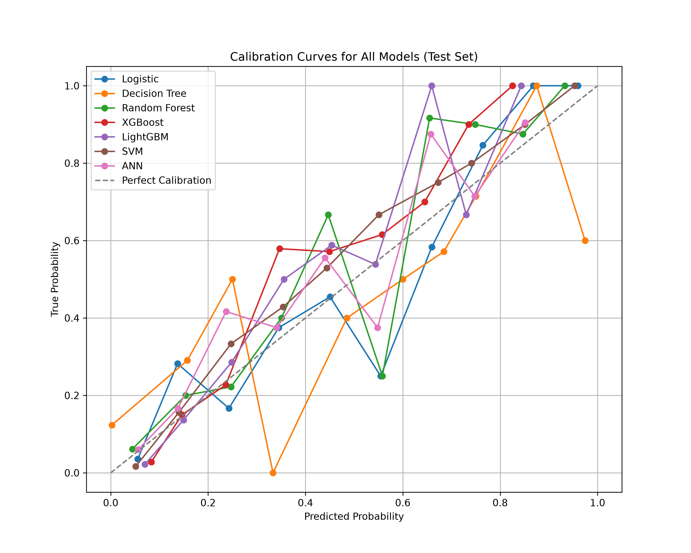</a></td>
    <td><a href="outputs/figures/evaluation/DCA_curves_allmodel_test.png">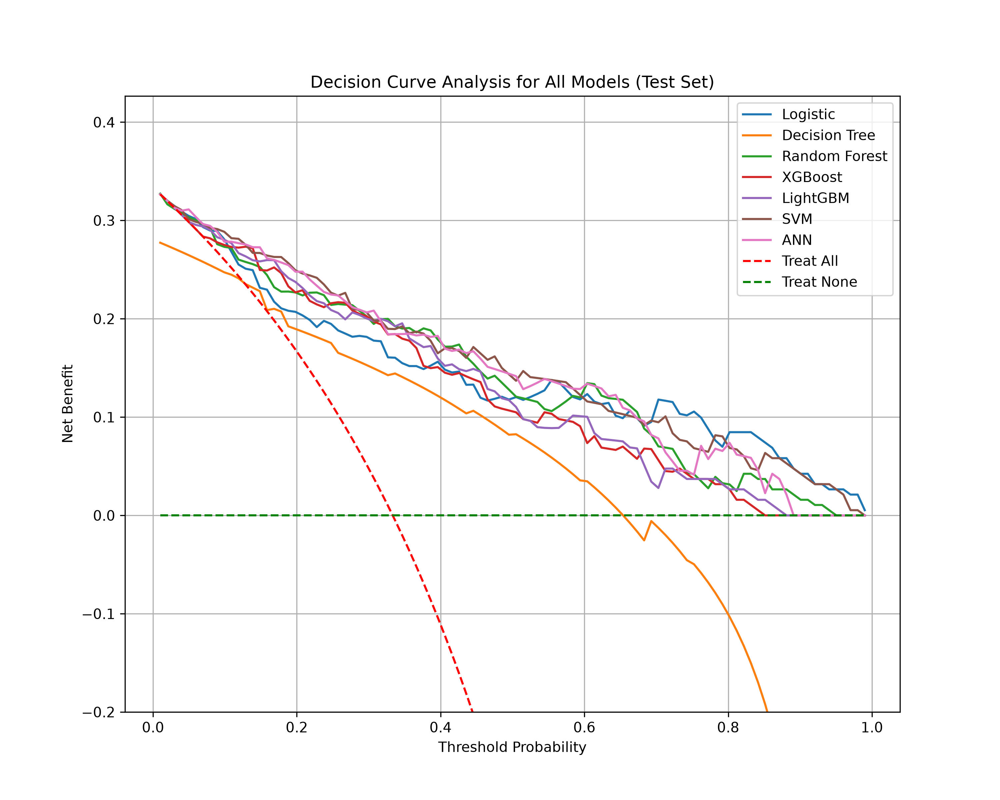</a></td>
  </tr>
</table>

<details>
<summary>Additional visualizations: Validation-set figures (click to expand)</summary>

<table>
  <tr>
    <th width="50%">Validation ROC curves</th>
    <th width="50%">Random Forest · validation confusion matrix</th>
  </tr>
  <tr>
    <td><a href="outputs/figures/evaluation/ROC_curves_allmodel_validation.png">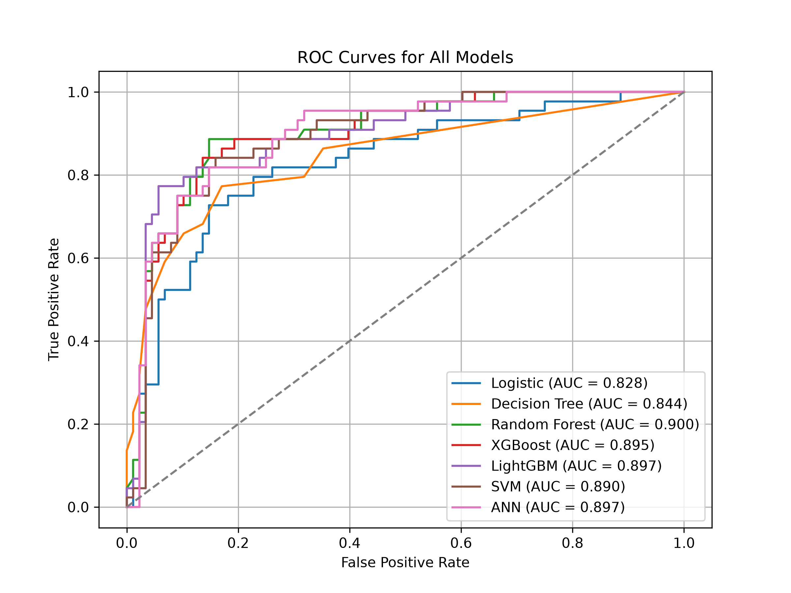</a></td>
    <td><a href="outputs/figures/evaluation/confusion_matrix_rf_validation.png">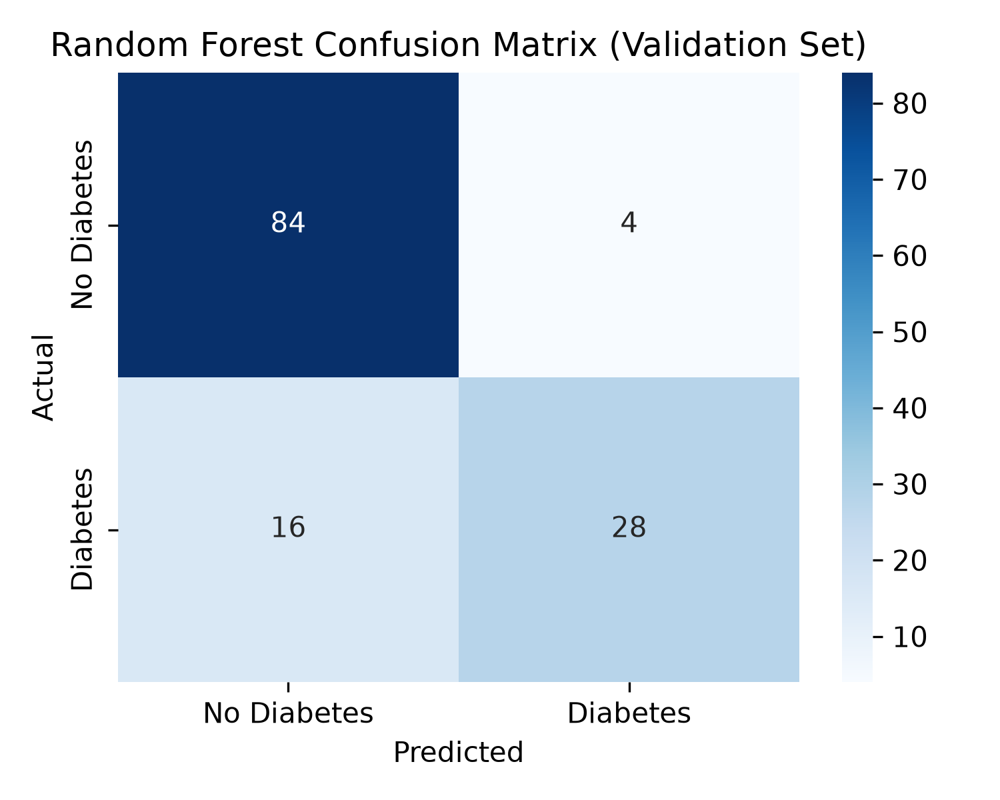</a></td>
  </tr>
</table>

<table>
  <tr>
    <th width="50%">Validation calibration curves</th>
    <th width="50%">Validation decision curves</th>
  </tr>
  <tr>
    <td><a href="outputs/figures/evaluation/Calibration_curves_allmodel_validation.png">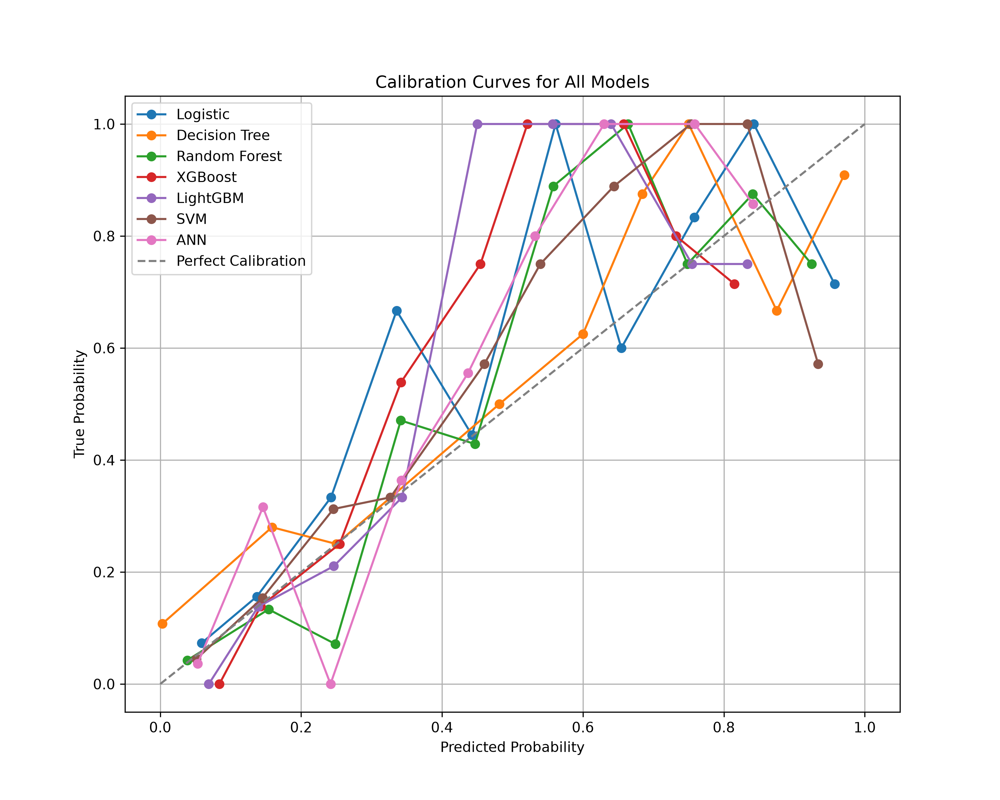</a></td>
    <td><a href="outputs/figures/evaluation/DCA_curves_allmodel_validation.png">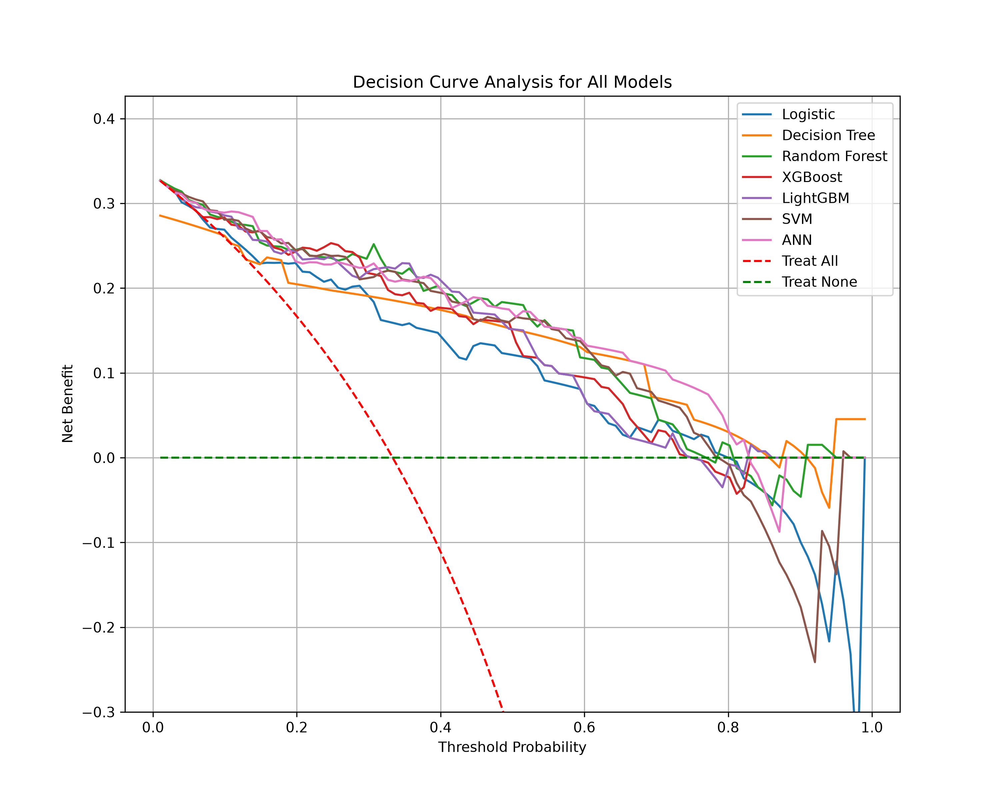</a></td>
  </tr>
</table>

</details>

## SHAP interpretation

All seven models are explained with `KernelExplainer` on the **class-1 probability scale**, using **50 training-background samples** and the **first 50 test samples**. The background sample and approximation use fixed random seeds. Random Forest examples cover every plot type below; [all-model outputs](outputs/figures/shap/) are also included.

<table>
  <tr>
    <th width="50%">Bar · global feature importance</th>
    <th width="50%">Beeswarm · contribution direction and distribution</th>
  </tr>
  <tr>
    <td><a href="outputs/figures/shap/bar_rf.png">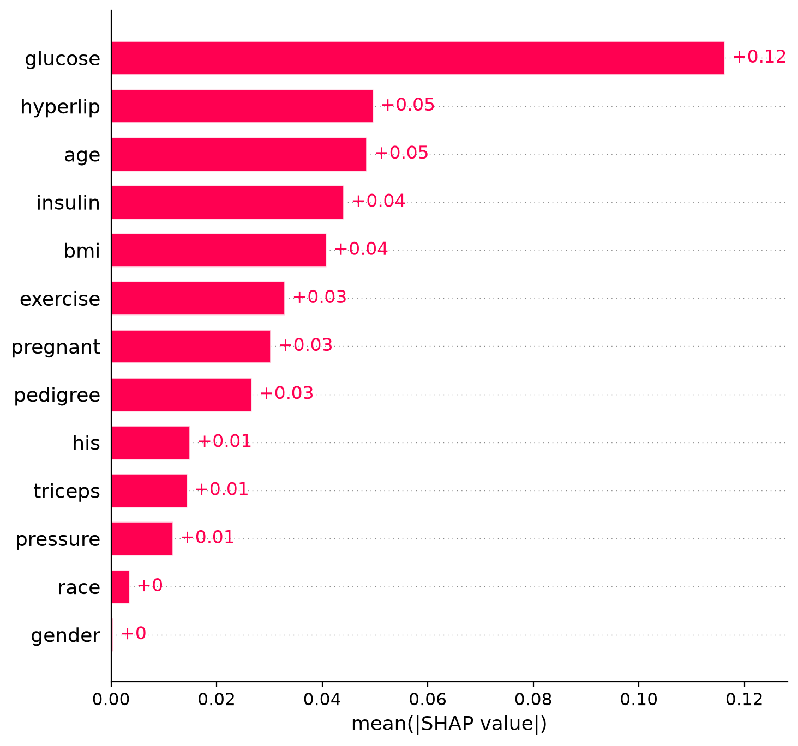</a></td>
    <td><a href="outputs/figures/shap/beeswarm_rf.png">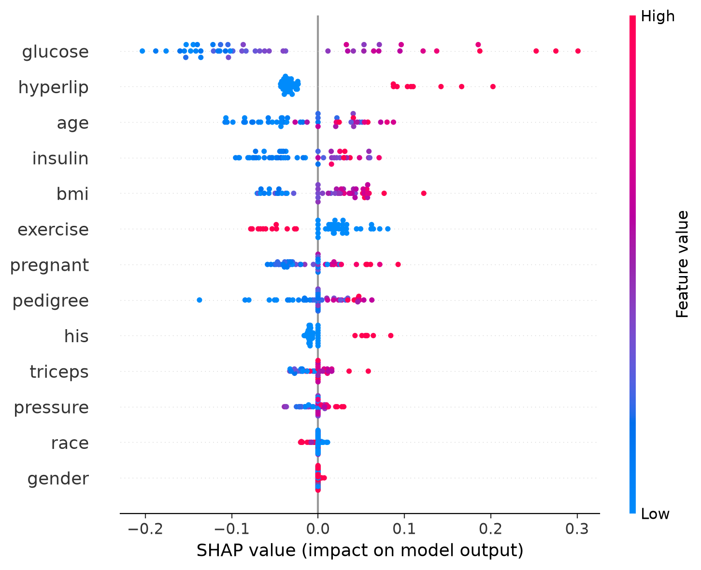</a></td>
  </tr>
</table>

<table>
  <tr>
    <th width="50%">Dependence · age, colored by gender</th>
    <th width="50%">Waterfall · one prediction</th>
  </tr>
  <tr>
    <td><a href="outputs/figures/shap/scatter_rf.png">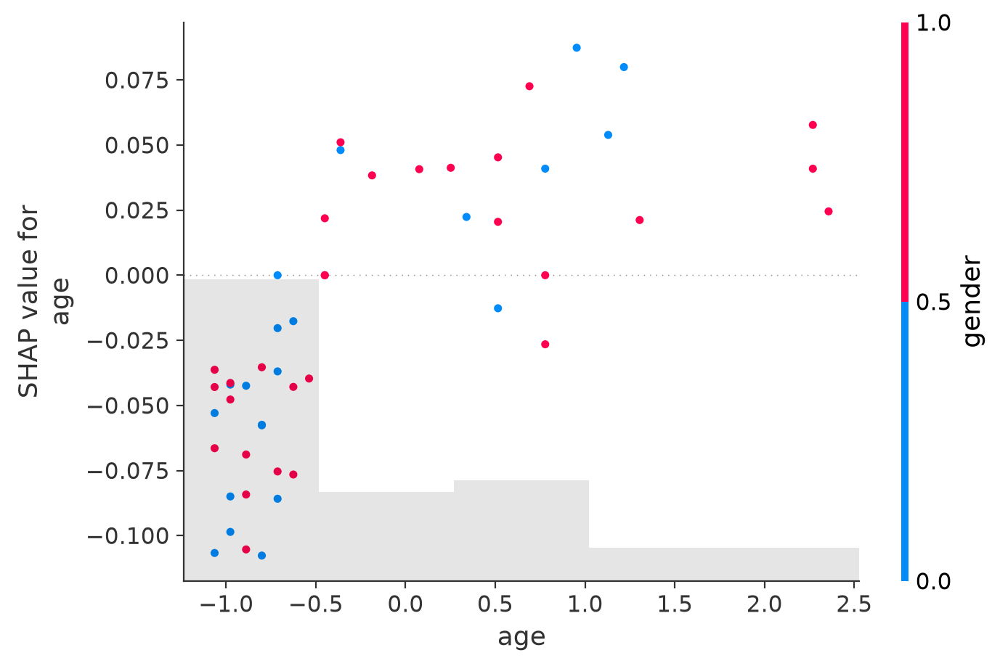</a></td>
    <td><a href="outputs/figures/shap/waterfall_5_rf.png">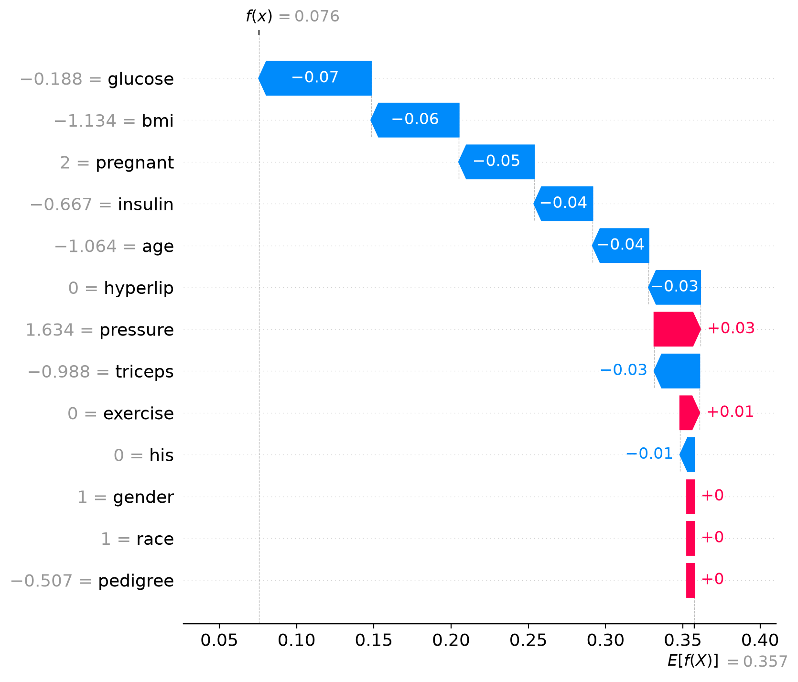</a></td>
  </tr>
</table>

**Force plot · one sample**

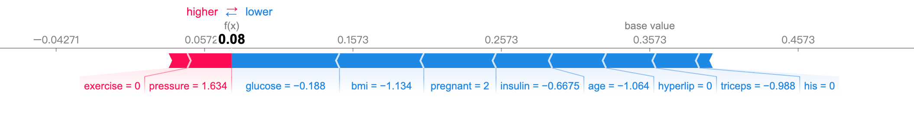

**Force plot · 50 samples**

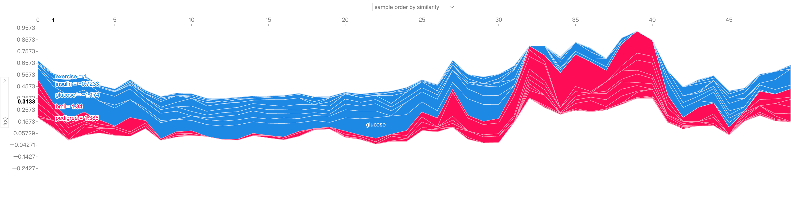

Interactive HTML: [one sample](outputs/figures/shap/force_plot_sig_5_rf.html) · [50 samples](outputs/figures/shap/force_plot_all_rf.html). Download and open in a browser to explore individual contributions. The PNG previews are browser captures of these HTML plots.

## Run locally

Python is pinned in [`.python-version`](.python-version); dependencies are declared in [`pyproject.toml`](pyproject.toml) and locked in [`uv.lock`](uv.lock).

With [uv](https://docs.astral.sh/uv/getting-started/installation/) installed, run from the repository root:

```bash
uv sync --locked
MPLBACKEND=Agg uv run --locked python main.py
```

`Agg` saves figures without opening plot windows. For Windows PowerShell:

```powershell
uv sync --locked
$env:MPLBACKEND = "Agg"
uv run --locked python main.py
```

The script writes processed data, fitted models, evaluation tables, saved comparison figures, and SHAP PNG/HTML files to `outputs/`. Rerunning replaces generated files. The included Random Forest confusion-matrix PNGs and force-plot screenshots are additional display assets.

For step-by-step exploration, follow the section headings and detailed Chinese comments in [main.py](main.py). The [learning notes](LEARNING_NOTES.md) provide the accompanying explanations and figure-reading guide.

## Repository structure

```text
tabular-ml-binary-classification/
├── data/                               # Synthetic diabetes dataset
│   └── synthetic_diabetes.csv
├── outputs/                            # Processed datasets, models, tables, and figures
│   ├── data_processed/
│   ├── data_splits/
│   ├── figures/
│   │   ├── eda/
│   │   ├── evaluation/
│   │   ├── models/
│   │   └── shap/
│   ├── models/
│   ├── tables/
│   └── significant_vars.pkl
├── .gitattributes                      # Excludes generated SHAP HTML from language statistics
├── .gitignore                          # Excludes local environments and caches
├── .python-version                     # Python version (3.13.2)
├── LEARNING_NOTES.md                   # Chinese machine learning notes
├── README.md                           # Project overview and reproducibility guide
├── main.py                             # Complete analysis with detailed Chinese comments
├── pyproject.toml                      # Python project configuration and dependencies
└── uv.lock                             # Locked Python package dependencies
```
